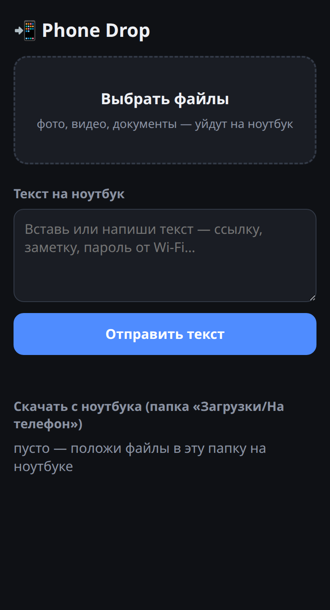
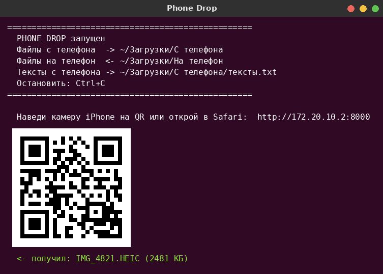

# 📲 Phone Drop

**Передача файлов и текста между iPhone и компьютером на Linux или Windows без интернета, без облаков и без установки приложений на телефон.**

Ноутбук поднимает маленький сайт в локальной сети, телефон открывает его в Safari по QR-коду — и можно кидать фото, видео, документы и текст в обе стороны.

<p align="center">
  
  &nbsp;&nbsp;
  
</p>

## Зачем

AirDrop между iPhone и Linux не работает, а по USB Linux видит айфон только с плясками. При этом iPhone умеет раздавать сеть по кабелю или Wi-Fi («Режим модема») — а значит, телефон и ноутбук оказываются в одной сети. Phone Drop этим пользуется: **интернет не нужен вообще**, данные идут напрямую.

## Возможности

- 📷 **Файлы с телефона → на ноутбук** — сразу несколько, с полоской прогресса, большие видео тоже (пишутся на диск кусками, память не забивается)
- 💻 **Файлы и текст с ноутбука → на телефон** — при запуске на ноуте открывается страница отправки: перетащил файлы или вставил текст, и через пару секунд они появляются на телефоне (страница обновляется сама, новое подсвечено, у текста кнопка «Скопировать», фото можно сохранить сразу в «Фото»)
- 📝 **Текст с телефона** — вставил ссылку или заметку, нажал «Отправить» — текст появляется в окне, сохраняется в `тексты.txt` и **сразу попадает в буфер обмена** (если стоит `xclip`)
- 🔳 **QR-код в терминале** — не нужно вбивать адрес; подключил кабель после запуска — новый QR появится сам
- 📦 **Ноль зависимостей** — только стандартная библиотека Python 3, даже QR-код генерируется своим кодом

## Windows

Скачай **[PhoneDrop.exe](https://github.com/bksqj/phone-drop/releases/latest/download/PhoneDrop.exe)** — Python ставить не нужно, просто запусти.

1. На iPhone: **Настройки → Режим модема → «Разрешать другим»**, подключи компьютер к Wi-Fi айфона
2. Запусти `PhoneDrop.exe`
   - «Система Windows защитила ваш компьютер» → **Подробнее → Выполнить в любом случае** (exe не подписан)
   - брандмауэр спросит про доступ к сети → поставь **обе галочки** (частные и общественные) → «Разрешить доступ»
3. Наведи камеру iPhone на QR-код в окне

Файлы падают в `Загрузки\С телефона`, текст с телефона сразу попадает в буфер обмена. По кабелю айфон работает как сеть, только если стоит приложение **Apple Devices** или iTunes.

Если Python есть — можно и без exe: `python drop.py`.

## Быстрый старт (Linux)

```bash
git clone https://github.com/bksqj/phone-drop.git
cd phone-drop
./install.sh        # создаст ярлык «Phone Drop» на рабочем столе (один раз)
```

Дальше:

1. На iPhone: **Настройки → Режим модема → «Разрешать другим»**
2. Подключи iPhone к ноутбуку **кабелем** (или подключи ноутбук к Wi-Fi айфона)
3. Запусти **Phone Drop** ярлыком (или `python3 drop.py`)
4. Наведи камеру iPhone на QR-код в окне → откроется страница
5. «Выбрать файлы» или вставить текст → «Отправить»
6. Чтобы отправить **на телефон** — перетащи файлы в окно браузера «Phone Drop: отправка на телефон», которое открылось на ноутбуке (адрес `http://127.0.0.1:8000/pc`)

Остановить: `Ctrl+C`, потом `Enter`.

### Куда что попадает

| Что | Папка |
|---|---|
| Файлы с телефона | `~/Загрузки/С телефона/` |
| Тексты с телефона | `~/Загрузки/С телефона/тексты.txt` |
| Файлы для телефона | `~/Загрузки/На телефон/` — сюда кладёт страница отправки; можно класть и руками |

(На системе с английской локалью — `~/Downloads/...`.)

## Если страница не открывается

**Брандмауэр.** В Ubuntu часто включён `ufw`, он режет входящие подключения. Открыть порт один раз:

```bash
sudo ufw allow 8000/tcp
```

**Разные сети.** Телефон и ноутбук должны быть в одной сети. Надёжнее всего — кабель + «Режим модема»: адрес будет вида `http://172.20.10.2:8000`. Некоторые домашние и гостевые Wi-Fi-роутеры не пускают устройства друг к другу.

**Буфер обмена.** Чтобы текст сразу копировался: `sudo apt install xclip`.

## Как это устроено

```
 iPhone (Safari)                         Ноутбук (python3 drop.py)
 ───────────────                         ─────────────────────────
 страница  ── GET /           ────────►  отдаёт HTML-страницу
 файл      ── POST /upload    ────────►  пишет поток в .part → переименовывает
 текст     ── POST /text      ────────►  печатает, сохраняет, кладёт в буфер (xclip)
 список    ── GET /list       ────────►  файлы «На телефон» + тексты с ноутбука (опрос раз в 2 с)
 скачать   ── GET /get/<имя>  ────────►  отдаёт файл (/view/<имя> — открыть фото в Safari)

 Ноутбук (браузер, только 127.0.0.1)
 ──────────────────────────────────
 страница  ── GET /pc         ────────►  отправка на телефон
 файл      ── POST /pc/upload ────────►  кладёт в «На телефон»
 текст     ── POST /pc/text   ────────►  держит последние 20 текстов в памяти
```

| Файл | Что делает |
|---|---|
| `drop.py` | HTTP-сервер (`ThreadingHTTPServer`) и встроенная страница для телефона |
| `qr.py` | Генератор QR-кодов с нуля: байтовый режим, коды Рида–Соломона над GF(256), 8 масок со штрафами, вывод в терминал символами `▀` |
| `start.sh` | Запуск: открывает папку с полученными файлами и стартует сервер |
| `install.sh` | Создаёт ярлык на рабочем столе с правильным путём к папке |

Интересные детали:

- **Файл не читается в память целиком** — тело запроса копируется на диск блоками по 1 МБ во временный `.part`, и только после полной загрузки переименовывается. Оборванная загрузка не оставит битый файл.
- **Имена файлов не перезаписываются** — если `photo.jpg` уже есть, сохранится `photo (1).jpg`.
- **Отправлять на телефон можно только с самого ноутбука** — страница `/pc` и её команды отвечают только на запросы с `127.0.0.1`, из сети будет 403.
- **Нельзя выйти за пределы папки** — имя файла чистится через `basename`, так что `../../.bashrc` не сработает.
- **QR-код проверен** — сгенерированные коды распознаются декодером OpenCV для версий 1–5.

## Ограничения

- Нет шифрования и пароля — запускай только в своей сети (кабель или свой «Режим модема»). Любой, кто в той же сети и знает адрес, может открыть страницу, пока программа запущена.
- Сделано и проверено под Ubuntu (GNOME). Windows-версия проверена под Wine; ярлык (`install.sh`) — только для Linux.

## Требования

- Python 3.8+
- Linux (проверено на Ubuntu 24.04) или Windows 10/11
- iPhone с Safari (Android тоже работает — в любом браузере)
